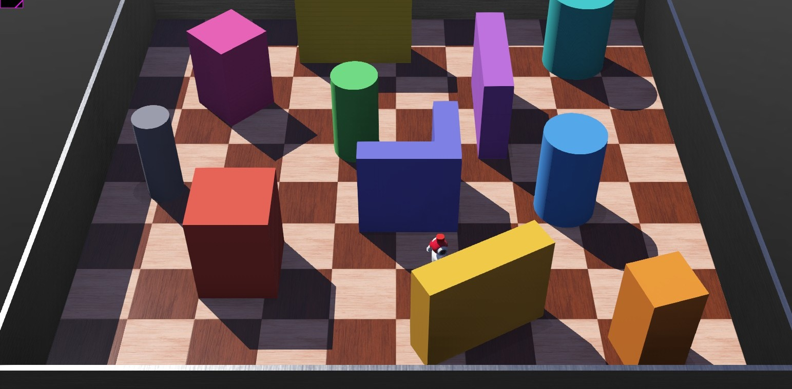
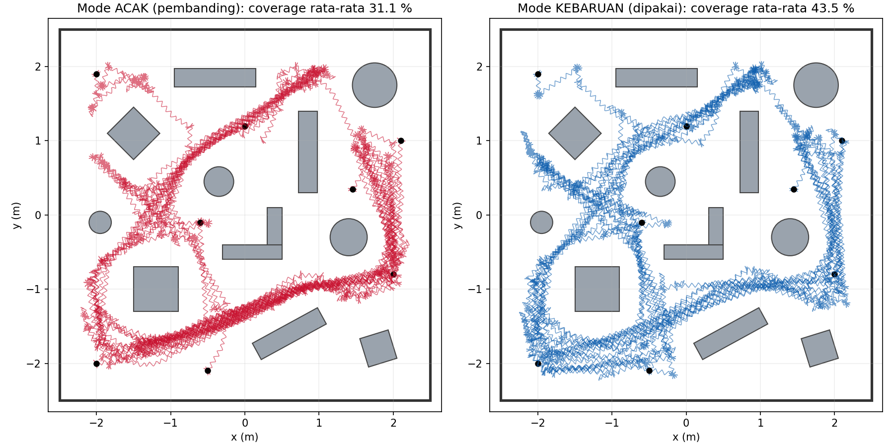
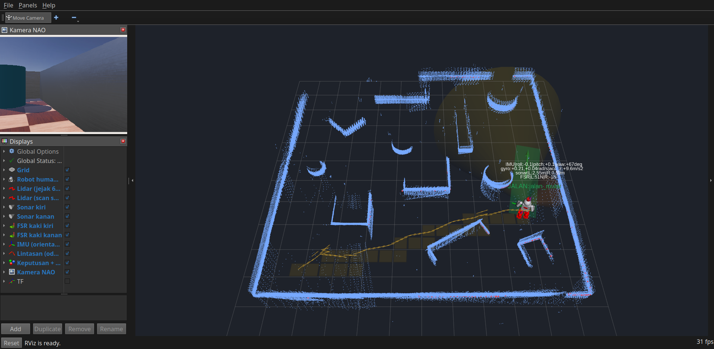

# Robot Humanoid Obstacle Avoidance: Tugas Pelatihan Lab B401

Humanoid **NAO (25 sendi)** di **Webots** yang berjalan dengan dua kaki menjelajahi arena 5 × 5 m berisi **12 obstacle** tanpa menabrak dan tanpa jatuh.
Sensor utama: **Lidar 360° di atas kepala**. Sensor pendukung: sonar, IMU, gyro, accelerometer, GPS, sensor gaya kaki (FSR), kamera, dan posisi sendi. Semua sensor bisa dipantau di **RViz2**.

📄 **Laporan (PDF):** [`docs/Laporan_Obstacle_Avoidance_B401.pdf`](docs/Laporan_Obstacle_Avoidance_B401.pdf)
🖥️ **Slide presentasi (PDF):** [`slides/Presentasi_Obstacle_Avoidance_B401.pdf`](slides/Presentasi_Obstacle_Avoidance_B401.pdf)



## Hasil uji

Uji otomatis: **16 posisi awal × 2 mode × 10 menit = 32 uji (5.3 jam simulasi)**.

| Mode | Tabrakan | Jatuh | Jarak total | Coverage rata-rata (min–maks) |
|---|---|---|---|---|
| **Kebaruan** (dipakai) | **0** | **0** | 681 m | **42.9 %** (27.9–48.8) |
| Acak (pembanding) | 0 | 0 | 704 m | 30.3 % (19.4–37.3) |

Eksplorasi kebaruan menaikkan coverage **42 %** dengan posisi awal, durasi, dan aturan keselamatan yang sama.

Tabrakan dideteksi dari kontak fisik (physics engine) oleh robot evaluator (Supervisor). Detektor ini sudah divalidasi dengan humanoid "buta" yang sengaja ditabrakkan.





## Ketentuan tugas

| Ketentuan | Implementasi |
|---|---|
| Robot obstacle avoidance | Humanoid berjalan otonom, Lidar + koridor selebar badan, state machine |
| Bentuk robot bebas | Humanoid NAO 25 sendi, digerakkan **gait engine buatan sendiri** |
| Obstacle di arena, tidak hanya pinggiran | 12 obstacle 0.8 m: kotak, kotak miring, tabung, dinding, siku-L |
| Sensor bebas | Lidar 360° (kepala), sonar, IMU, gyro, accelerometer, GPS, FSR, kamera |

## Cara kerja

**Gait engine** ([`gait.py`](controllers/humanoid_avoidance/gait.py)) mengendalikan setiap sendi langsung dari keyframe file `.motion`:
- **Transisi halus** `s(u) = 3u² − 2u³` dari pose saat ini ke pose awal gerakan. Tanpa transisi ini, motion bawaan membuat robot jatuh pada detik ke-1.2.
- **Siklus jalan kontinu**: frame 51–102 di Forwards50 identik di kedua ujungnya, jadi siklus 2 langkah (2.04 s, +0.18 m) bisa diulang terus.
- **Belok sambil jalan**: satu pulsa 0.25 rad pada sendi HipYawPitch per siklus, menghasilkan +17° ke kiri atau −13° ke kanan per siklus.
- **Putar 20°/40°/60°/balik, mundur, maju kecil**. Semua sudah diukur dan tidak ada yang membuat robot jatuh.

**Navigasi** ([`humanoid_avoidance.py`](controllers/humanoid_avoidance/humanoid_avoidance.py)):
1. Untuk 36 arah, hitung jarak bebas koridor selebar 2 × 0.25 m dari titik Lidar.
2. `skor(θ) = min(bebas,2)/2 + 0.6·K(θ) − 0.35·|θ|/π − 0.25·|Δψ_tujuan|/π`, dengan K(θ) = kebaruan, yaitu rata-rata `1/(1+kunjungan)` sel grid 0.25 m ke arah θ.
3. State machine SIAP / JALAN (lurus, kiri, kanan) / BERHENTI / PUTAR / MUNDUR / BANGUN. Dilengkapi aturan keselamatan (ruang putar 0.33 m, sonar dengan konfirmasi Lidar) dan watchdog (macet, terjebak di area sempit).

## Cara menjalankan

1. Instal [Webots R2025a](https://cyberbotics.com) dan Python 3.
2. `git clone https://github.com/ahnafyura/webots-obstacle-avoidance-b401.git`
3. Webots: **File → Open World…**, pilih `worlds/obstacle_avoidance.wbt`, lalu tekan **Play** ▶.

Console menampilkan state robot setiap detik. Evaluator mencetak jumlah tabrakan, jatuh, dan coverage setiap 10 detik.

### Semua sensor di RViz2 (ROS 2 Jazzy)

```bash
tools/rviz.sh     # Webots + robot_state_publisher + RViz2
```

| Topic | Isi |
|---|---|
| `/scan` | Lidar 360° |
| `/sonar/left`, `/sonar/right` | sonar dada (`Range`) |
| `/imu` | orientasi + gyro + accelerometer |
| `/fsr/left`, `/fsr/right` | gaya telapak kaki (`WrenchStamped`) |
| `/camera/image_raw` | kamera NAO |
| `/joint_states` + `/robot_description` | model humanoid bergerak (URDF) |
| `/odom`, `/tf`, `/oa/decision` | lintasan, frame, koridor, state, sel dikunjungi |

URDF dibuat oleh `tools/make_urdf.py`: hasil ekspor Webots (kaki) ditambah lengan, kepala, Lidar, dan kamera, karena Hinge2Joint belum didukung oleh ekspor URDF Webots.

### Uji otomatis (headless)

```bash
tools/stress_test.sh 600 kebaruan                 # 8 posisi awal x 10 menit
tools/stress_test.sh 600 acak                     # pembanding
STARTS_SET=2 tools/stress_test.sh 600 kebaruan    # set posisi awal kedua
python3 tools/plot_results.py                     # grafik -> docs/images
python3 tools/make_report.py                      # laporan PDF
python3 slides/buat_slide.py                      # slide PDF
```

## Struktur

```
worlds/obstacle_avoidance.wbt          arena 5x5 m + 12 obstacle + humanoid + evaluator (dibuat tools/make_world.py)
controllers/humanoid_avoidance/        controller, gait engine, ROS 2 bridge, file motion
controllers/evaluator/                 supervisor penguji (tabrakan, jatuh, clearance, coverage)
rviz/                                  konfigurasi RViz2 + URDF humanoid
tools/                                 uji otomatis, grafik, generator laporan & world & URDF
docs/  slides/                         laporan PDF, slide PDF, gambar
```

Versi sebelumnya (robot beroda differential drive) tersimpan di tag [`v1-robot-roda`](../../tree/v1-robot-roda).
