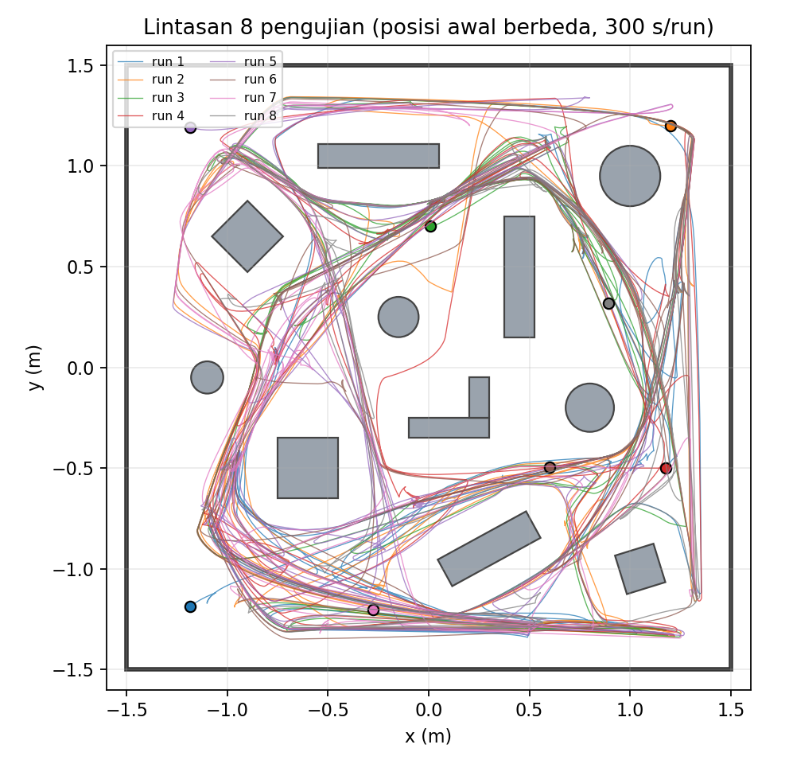
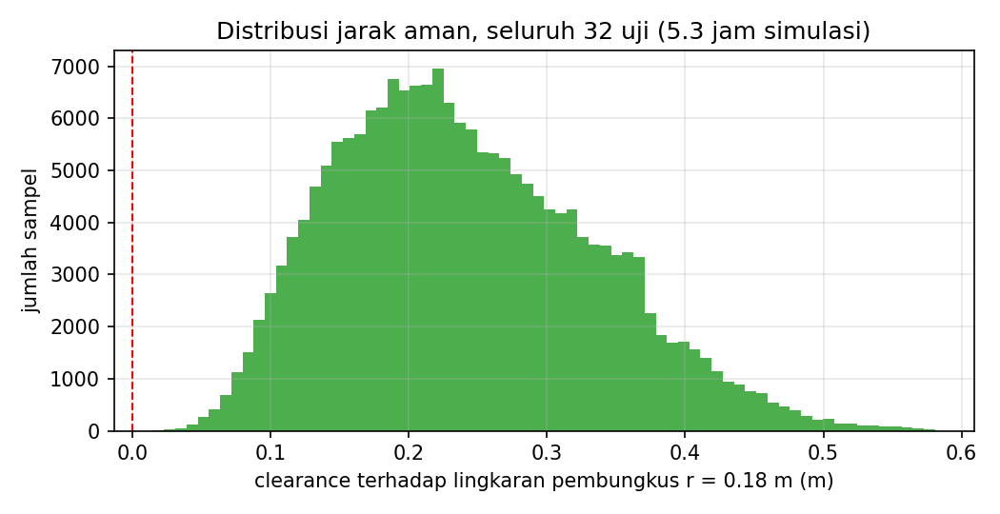

# Robot Obstacle Avoidance — Tugas Pelatihan Lab B401

Robot differential drive kustom di **Webots** yang menjelajahi arena 3 × 3 m berisi **12 obstacle** tanpa menabrak.
Sensor utama **Lidar 360°**, dibantu **3 sensor ultrasonik** sebagai lapisan safety dan **encoder roda** untuk odometri heading.

📄 **Laporan lengkap (PDF):** [`docs/Laporan_Obstacle_Avoidance_B401.pdf`](docs/Laporan_Obstacle_Avoidance_B401.pdf)  
🖥️ **Slide presentasi (PDF):** [`slides/Presentasi_Obstacle_Avoidance_B401.pdf`](slides/Presentasi_Obstacle_Avoidance_B401.pdf) (sumber: `slides/slides.html`, render: `python3 slides/buat_slide.py`)


## Hasil Uji

Uji otomatis: 8 posisi awal × 300 detik simulasi. Tabrakan dideteksi dari *contact points* physics engine oleh Supervisor evaluator.

| Total waktu | Total jarak | **Tabrakan** | Clearance min* | Coverage rata-rata (5 menit) |
|---|---|---|---|---|
| 40 menit | 528 m | **0** | 2.4 cm | 54.9 % |

\*Diukur terhadap lingkaran pembungkus robot (r = 10 cm), jadi jarak body robot ke obstacle sebenarnya lebih besar.

<p align="center"> </p>

## Ketentuan Tugas

| Ketentuan | Implementasi |
|---|---|
| Robot obstacle avoidance | Navigasi otonom *Corridor Gap Selection* + state machine |
| Bentuk robot bebas (boleh sama dengan modul) | Robot kustom dengan struktur seperti modul: body Box, 2× HingeJoint + motor, kastor BallJoint |
| Obstacle di arena, tidak hanya pinggiran | 12 obstacle: kotak, kotak miring, tabung, dinding, siku-L |
| Sensor bebas | Lidar 360° + 3 ultrasonik (sonar) + 2 encoder |

## Algoritma (singkat)

1. Scan Lidar (360 sinar) diubah ke titik (x, y) dalam frame robot.
2. Untuk 61 kandidat arah (−150°…150°), dihitung **jarak bebas koridor** selebar robot + margin.
3. Skor = `min(bebas, 1 m) − 0.15·|θ − θ_jelajah| − 0.08·|θ − θ_sebelumnya|`. Arah terbaik dipilih,
   lalu `ω = 2.8·θ` dan `v` diskalakan dengan jarak bebas di depan.
4. State machine: **JELAJAH → MUNDUR** (obstacle < 13 cm, sonar < 5 cm, atau macet) **→ PUTAR** (rotasi sampai koridor depan > 45 cm) **→ JELAJAH**.
5. θ_jelajah adalah arah global acak yang diganti tiap 5–10 s dan dikonversi ke frame robot memakai odometri encoder, supaya robot menjelajah dan tidak berputar di satu lintasan.

## Cara Menjalankan

1. Instal [Webots R2025a](https://cyberbotics.com) (atau versi yang lebih baru) dan Python 3.
2. `git clone https://github.com/ahnafyura/webots-obstacle-avoidance-b401.git`
3. Di Webots: **File → Open World…** → `worlds/obstacle_avoidance.wbt` → **Play** ▶.
4. Opsional: **View → Optional Rendering → Show Lidar Ray Paths** untuk menampilkan sinar Lidar.

Console menampilkan telemetri robot setiap detik dan ringkasan evaluator (tabrakan, clearance, coverage) setiap 10 detik.

### Uji otomatis (headless, Linux)

```bash
tools/run_test.sh 180            # 1 run, 180 s -> logs/summary.json
tools/stress_test.sh 300         # 8 run dari posisi awal berbeda
python3 tools/plot_results.py    # grafik -> docs/images/
python3 tools/make_report.py     # laporan PDF -> docs/
```

Variabel lingkungan: `WEBOTS` (path executable), `EVAL_START="x,y,yaw"`, `OA_SEED`, `EVAL_SNAPSHOTS="1,30"`, `EVAL_VIEW=top|follow|oblique`.

## Struktur

```
worlds/obstacle_avoidance.wbt        arena + obstacle + robot + evaluator
controllers/obstacle_avoidance/      controller robot (Python)
controllers/evaluator/               supervisor penguji (tabrakan, clearance, coverage)
tools/                               skrip uji, grafik, generator PDF
docs/                                laporan PDF, gambar, hasil uji
```

Catatan: urutan sinar Lidar sudah diverifikasi lewat uji di world. Indeks 0 mengarah ke belakang robot, lalu searah jarum jam (90 = kiri, 180 = depan, 270 = kanan).
